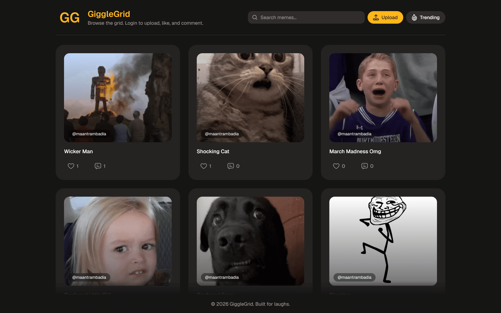
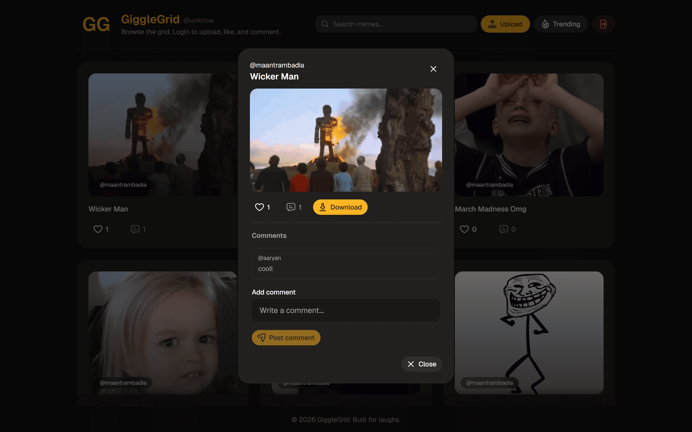
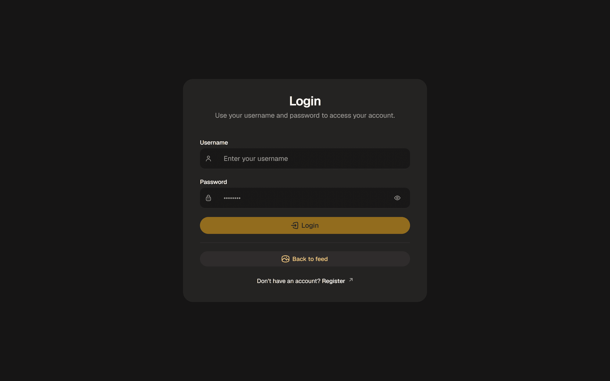
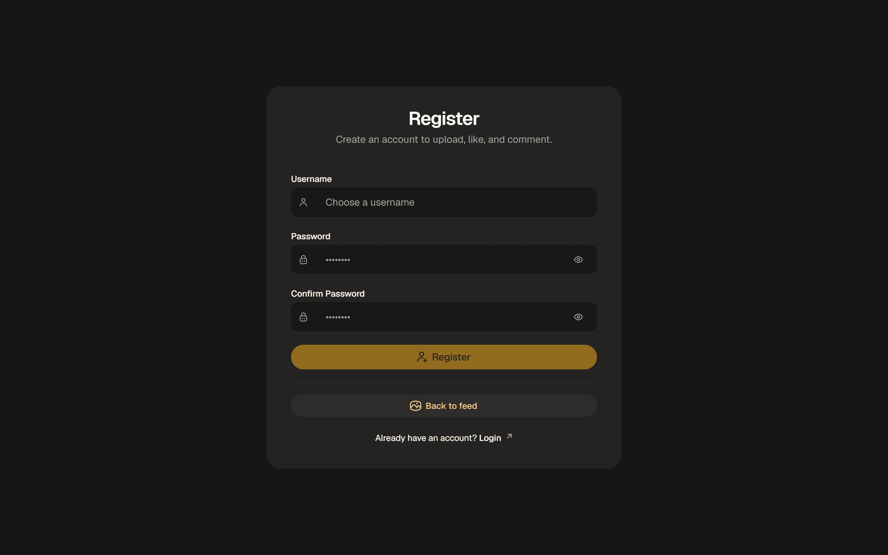
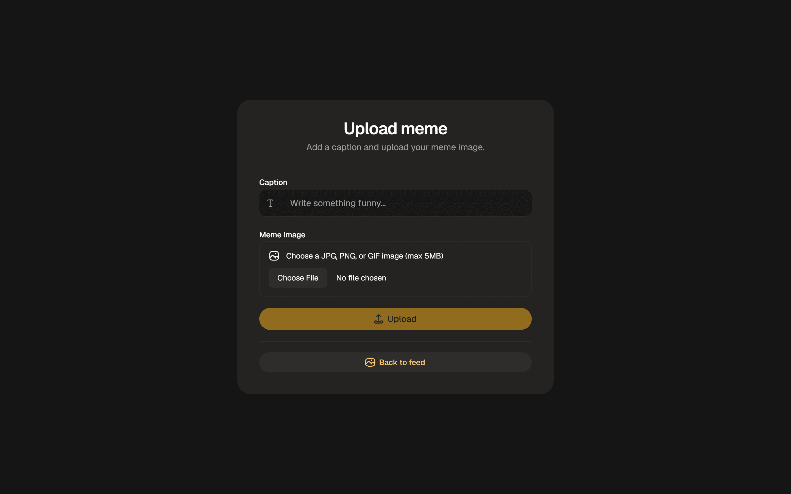

# GiggleGrid

## Project Title and Description

**Project Title:** GiggleGrid

**Description:** GiggleGrid is a fun and interactive meme sharing platform. It is a website where users can create an account, upload their favourite memes, and enjoy memes shared by other users. Users can like memes, write comments, and see trending memes that are getting the most likes. The main aim of this project is to build a simple and clean social platform where people can share laughter in one place.

The name "GiggleGrid" comes from two words, "Giggle" (which means to laugh) and "Grid" (which means the grid-like wall of memes shown on the home page).

## Technologies and Tools Used

### Frontend

| Technology           | Purpose                                             |
| :------------------- | :-------------------------------------------------- |
| React.js (v19)       | JavaScript library used to build the user interface |
| Vite                 | Build tool and local development server             |
| Tailwind CSS (v4)    | Used for styling the pages                          |
| HeroUI               | Ready-made UI component library                     |
| React Router         | Used to move between pages (navigation)             |
| TanStack React Query | Used to fetch and manage API data                   |
| Axios                | Used to send HTTP requests to the backend           |
| Motion               | Used for small animations                           |
| HugeIcons            | Icon library                                        |

### Backend

| Technology                | Purpose                                       |
| :------------------------ | :-------------------------------------------- |
| Java 17                   | Main programming language of the backend      |
| Spring MVC (v5.3)         | Framework used to build REST APIs             |
| Hibernate ORM (v5.6)      | Used to connect Java with the database        |
| Jackson                   | Converts Java objects to JSON and back        |
| Apache Commons FileUpload | Used to upload meme image files               |
| JBCrypt                   | Used to safely store user passwords (hashing) |
| Maven                     | Build tool used to make the WAR file          |

### Database and Tools

| Technology      | Purpose                                     |
| :-------------- | :------------------------------------------ |
| MySQL / MariaDB | Stores all users, memes, likes and comments |
| Apache Tomcat   | Server used to run the backend WAR file     |
| Git & GitHub    | Version control and code hosting            |
| VS Code / IDE   | Code editor                                 |

## Features and Functionalities

- **User Registration**: A new user can create an account with a username and password. The password is stored in encrypted (hashed) form.
- **User Login / Logout**: Registered users can log in to their account and log out safely.
- **Upload Memes**: Logged in users can upload meme images. JPG, PNG, GIF and WEBP formats are supported, along with a caption.
- **Public Meme Feed**: All users can scroll through a grid of memes shared by everyone.
- **Like and Unlike**: Users can like a meme and remove their like. One user can like a meme only once.
- **Comments**: Users can write comments on memes and see what others wrote.
- **Delete Own Memes**: A user can delete only the memes they uploaded.
- **Trending Memes**: Memes are sorted by the number of likes, so the best ones come on top.
- **Download Memes**: Users can download any meme image to their device.
- **Protected Pages**: Pages like Upload can be opened only after login.
- **Dark Theme & Responsive Design**: The site has a modern dark theme and works on both mobile and desktop screens.
- **Smooth Loading**: Loading skeletons and animation are shown while data is being fetched.

## Installation and Execution Instructions

### Requirements

- Java 17 (JDK)
- Apache Maven
- Apache Tomcat (v9 or above)
- Node.js (v18 or above) and npm
- MySQL or MariaDB server

### Step 1: Get the Code

```bash
git clone https://github.com/maantrambadia/giggle-grid.git
cd giggle-grid
```

### Step 2: Set Up the Database

Open MySQL and run the `database.sql` file given in the project. This creates the database and all tables.

```sql
source database.sql;
```

### Step 3: Set Up the Backend

1. Go to the `backend` folder.
2. Copy `.env.example` and rename it to `.env`.
3. Fill in your database details:

```env
DB_HOST=localhost
DB_PORT=3306
DB_NAME=gigglegrid
DB_USER=your_username
DB_PASSWORD=your_password
```

4. Build the WAR file:

```bash
mvn clean package
```

5. Copy the file `target/giggle-grid-backend.war` into the `webapps` folder of Tomcat, then start Tomcat.

The backend API will now run at: `http://localhost:8080/giggle-grid-backend`

### Step 4: Set Up the Frontend

```bash
cd frontend
npm install
npm run dev
```

The website will open at: `http://localhost:5173`

### Step 5: Build for Production (optional)

```bash
npm run build
```

The final website files will be created in the `dist` folder.

## Database Setup Instructions

**Database Name:** gigglegrid

The database uses the **utf8mb4** character set, so it supports all kinds of text and emojis.

### Tables

| Table    | Purpose                              |
| :------- | :----------------------------------- |
| users    | Stores account details of every user |
| memes    | Stores every uploaded meme           |
| likes    | Stores likes given by users on memes |
| comments | Stores comments on memes             |

### Setup Steps

1. Install MySQL or MariaDB.
2. Run the `database.sql` script, it creates the database and all four tables automatically.
3. Add the database username and password in the backend `.env` file.

### Important Rules

- A **unique rule** on (user_id, meme_id) in the likes table makes sure one user can like a meme only once.
- All foreign keys use **ON DELETE CASCADE**, which means if a user is deleted, their memes, likes and comments are also deleted automatically.

## Screenshots

<div align="center">

|                                                 |                                                     |
| :---------------------------------------------: | :-------------------------------------------------: |
|              **Home / Feed Page**               |                   **Meme Modal**                    |
|    |  |
|                 **Login Page**                  |                  **Register Page**                  |
|   |    |
|              **Upload Meme Page**               |                                                     |
|  |                                                     |

</div>

---

<div align="center">

**GitHub Repository:** [github.com/maantrambadia/giggle-grid](https://github.com/maantrambadia/giggle-grid)

**Deployed Application:** [gg.maantrambadia.com](https://gg.maantrambadia.com/)

</div>
